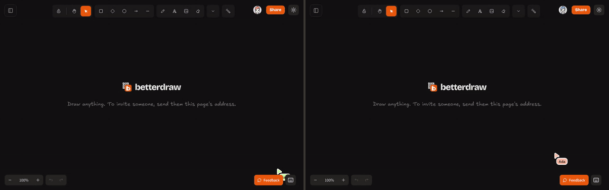

# betterdraw

A whiteboard for people and their AI agents. Every canvas lives on the server and is shared by sending its
address: people draw on it together, live, and agents read it and draw on it through MCP while everyone
watches. betterdraw is a fork of [Excalidraw](https://github.com/excalidraw/excalidraw), and it is
self-hosted with one container.



- **Open it and draw.** No sign-up, no lobby: the first visit opens a canvas.
- **Share by sending the URL.** Anyone with the link edits it live, with cursors and names. One click
  makes a canvas view-only or private.
- **Agents draw too.** Share gives a prompt and an MCP address for each canvas: an AI agent reads the
  canvas and draws on it with your access, live in front of everyone.
- **Keep your canvases everywhere** with an email link, Google, your company's single sign-on,
  or a password.
- **Everything on the server**: canvases, images and preferences follow the account.
  Export everything as `.excalidraw` files at any time; import them from excalidraw.com.
- **One container to host**: web app, realtime server, SQLite database and image store in one process.
  Postgres and S3 when you need them. No telemetry.

A hosted version runs at [betterdraw.dev](https://betterdraw.dev).

## Connect an agent

On a canvas, press **Share** at the top right. Under "Agents", copy the prompt and paste it to an AI
agent, or add the MCP address to an MCP client. The agent can then read that canvas and draw on it, with
your access, while you watch: a robot among the avatars, its cursor pointing at what it looks at, its
shapes appearing one by one, and a card that shows what it changed.

To give an agent all your canvases, create a key in Settings. For Claude Code:

```bash
claude mcp add --transport http betterdraw https://your-server/mcp --header "Authorization: Bearer <key>"
```

Any MCP client works with the same address and header. [docs/mcp.md](docs/mcp.md) covers the clients,
the tools, the HTTP API under `/api/v1`, the limits, and what a link or a key gives access to.

## Run it

In a clone of this repository:

```bash
docker compose -f deploy/docker-compose.yml up -d
```

Open http://localhost:3000.
[docs/self-hosting.md](docs/self-hosting.md) covers HTTPS, email, Google and SSO, Postgres, S3,
backups, updates and every setting.

## A fork of Excalidraw

The editor is a hard fork of Excalidraw: their packages live in `packages/`, under `@betterdraw/` names,
and we change them like the rest of the code. Their fixes come over by hand.
[docs/fork.md](docs/fork.md) says where the fork starts, what we changed and how to take a fix from
them. Thanks to the Excalidraw team for the editor this is built on.

## Develop

```bash
npm install
cp .env.example .env  # optional: without it, everything lives in ./data, with SQLite
npm run dev           # server on :3000, web app with hot reload on :5173
```

`npm run check` checks the types, `npm run build` builds the web app, and `npm test` runs the editor's
tests, locally (CI does not run them). [docs/vision.md](docs/vision.md) says what the project is for,
[docs/architecture.md](docs/architecture.md) how it works, and [.github/CONTRIBUTING.md](.github/CONTRIBUTING.md)
how to help.

## License

MIT. betterdraw is a fork of Excalidraw, also MIT: see [LICENSE](LICENSE) and [docs/fork.md](docs/fork.md).
It is not affiliated with the Excalidraw project. The fonts, icons and code it copies from other projects
are credited, with their licenses, in [THIRD_PARTY_NOTICES.txt](THIRD_PARTY_NOTICES.txt). A running
server serves these notices at `/licenses.txt`, followed by the licenses of every bundled package.
